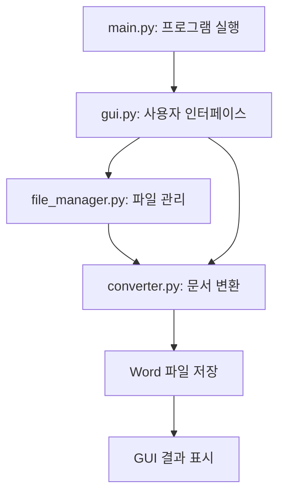

# MD to Word 팀 프로젝트 개발 가이드

## 1. 역할 분담

| 담당자 | 담당 기능 | 작업 파일 |
|---|---|---|
| 배정민 | A. 변환 기능 | converter.py |
| 배정민 | B. GUI | gui.py |
| 신재민 | C. 파일 관리 | file_manager.py |
| 김형호 | 통합, 테스트, 배포 | main.py |

### 2.2 프로젝트 다운로드

#### 2.2.1 VS Code 새 창 열기

- File → New Window
- 단축키: Ctrl + Shift + N

#### 2.2.2 프로젝트를 저장할 폴더 열기

- File → Open Folder
- 단축키: Ctrl + K를 누른 뒤 Ctrl + O
- 문서(Documents) 폴더에 Projects 폴더를 생성하고 선택

#### 2.2.3 터미널 열기

- Terminal → New Terminal
- 단축키: Ctrl + `

#### 2.2.4 GitHub 프로젝트 다운로드

```bash
git clone https://github.com/kimhohyeong2/md-to-word.git
```

#### 2.2.5 프로젝트 폴더 열기

```bash
cd md-to-word
code .
```

- code . 명령어가 작동하지 않으면 File → Open Folder에서 md-to-word 폴더를 직접 선택한다.
- 신뢰 여부를 묻는 창이 나오면 Yes, I trust the authors를 선택한다.
- 프로젝트가 열린 VS Code에서 터미널을 새로 열고 2.3단계부터 진행한다.
- 이후에는 git clone을 반복하지 않고 기존 md-to-word 폴더를 열어 작업한다.

### 2.3 가상환경 생성

```bash
python -m venv .venv
```

### 2.4 가상환경 활성화

Windows:

```powershell
.\.venv\Scripts\Activate.ps1
```

macOS:

```bash
source .venv/bin/activate
```

### 2.5 라이브러리 설치

```bash
python -m pip install -r requirements.txt
```

### 2.6 개인 작업 브랜치 생성

배정민:

```bash
git switch -c feature/converter-gui
```

신재민:

```bash
git switch -c feature/file-manager
```

김형호:

```bash
git switch -c feature/integration
```

## 3. 개별 기능 개발

### A. 변환 기능 (converter.py) — 배정민

- [ ] converter.py 파일 생성
- [ ] Markdown 파일 읽기
- [ ] Mistune을 이용한 Markdown 문법 분석
- [ ] python-docx를 이용한 Word 문서 생성
- [ ] 제목 변환 (#, ##, ###)
- [ ] 일반 본문 변환
- [ ] 굵게 및 기울임 변환
- [ ] 순서 있는 목록 변환
- [ ] 순서 없는 목록 변환
- [ ] 표 변환
- [ ] 이미지 삽입
- [ ] 글꼴 설정
- [ ] 글자 크기 설정
- [ ] 줄 간격 설정
- [ ] 문서 여백 설정
- [ ] .docx 파일 저장
- [ ] 개별 기능 테스트
- [ ] 오류 수정

### B. GUI (gui.py) — 배정민

- [ ] gui.py 파일 생성
- [ ] PyQt5를 이용한 기본 프로그램 창 생성
- [ ] 파일 선택 버튼 구현
- [ ] 폴더 선택 버튼 구현
- [ ] 선택된 파일 목록 표시
- [ ] 저장 경로 표시 및 변경 기능
- [ ] 글꼴 선택 기능
- [ ] 글자 크기 설정 기능
- [ ] 줄 간격 설정 기능
- [ ] 여백 설정 기능
- [ ] 변환 버튼 구현
- [ ] 변환 진행 상태 표시
- [ ] 변환 완료 메시지 표시
- [ ] 오류 메시지 표시
- [ ] 결과 폴더 열기 버튼 구현
- [ ] GUI 실행 테스트
- [ ] 오류 수정

### C. 파일 관리 (file_manager.py) — 신재민

- [ ] file_manager.py 파일 생성
- [ ] 파일 경로 받아오기
- [ ] 파일 존재 여부 확인
- [ ] .md 확장자 확인
- [ ] 폴더 내 Markdown 파일 탐색
- [ ] 여러 파일 목록 반환
- [ ] 기본 저장 경로 설정 (~/result/)
- [ ] 결과 저장 폴더 자동 생성
- [ ] 일괄 변환 시 날짜·시간별 폴더 생성
- [ ] 원본 파일명을 기반으로 결과 파일명 생성
- [ ] 동일한 이름의 파일이 존재할 경우 덮어쓰기 방지
- [ ] 잘못된 파일 경로 예외 처리
- [ ] 저장 권한 오류 처리
- [ ] 개별 기능 테스트
- [ ] 오류 수정

## 4. GitHub 업로드 (전원)

각자 담당 기능을 완성한 후 진행한다.

### 4.1 변경 사항 확인

```bash
git status
```

### 4.2 작업한 파일 추가

배정민:

```bash
git add converter.py gui.py
```

신재민:

```bash
git add file_manager.py
```

김형호:

```bash
git add main.py
```

### 4.3 변경 사항 저장

```bash
git commit -m "담당 기능 구현"
```

### 4.4 GitHub 업로드

```bash
git push -u origin HEAD
```

### 4.5 Pull Request 작성

- [ ] GitHub 저장소 접속
- [ ] Compare & pull request 클릭
- [ ] 구현한 기능 설명 작성
- [ ] Create pull request 클릭
- [ ] 팀장에게 검토 요청

팀원들은 직접 main 브랜치에 병합하지 않는다.

## 5. GitHub 병합 및 통합 — 김형호

- [ ] 팀원들의 Pull Request 확인
- [ ] 코드 검토
- [ ] 함수 이름 및 매개변수 확인
- [ ] 중복 기능 확인
- [ ] 라이브러리 누락 확인
- [ ] 필요한 경우 수정 요청
- [ ] Pull Request 승인
- [ ] main 브랜치에 병합
- [ ] 최신 코드 다운로드
- [ ] main.py 작성
- [ ] GUI와 파일 관리 기능 연결
- [ ] 파일 관리와 변환 기능 연결
- [ ] GUI 서식 설정과 변환 기능 연결
- [ ] 전체 프로그램 실행

### 프로그램 구조



## 6. 전체 프로그램 테스트 — 김형호

- [ ] 단일 Markdown 파일 변환
- [ ] 여러 Markdown 파일 일괄 변환
- [ ] 제목 및 본문 변환
- [ ] 표 및 이미지 변환
- [ ] 글꼴 및 크기 설정 적용
- [ ] 줄 간격 및 여백 설정 적용
- [ ] 한글·영어·일본어 파일 변환
- [ ] 빈 파일 처리
- [ ] 잘못된 확장자 처리
- [ ] 존재하지 않는 파일 처리
- [ ] 중복 파일명 처리
- [ ] 저장 권한 오류 처리
- [ ] Windows 실행 테스트
- [ ] macOS 실행 테스트
- [ ] 오류 수정

## 7. 배포 — 김형호

### 7.1 실행 파일 제작

- [ ] PyInstaller 설치 확인
- [ ] Windows 환경에서 EXE 제작

```bash
python -m PyInstaller --onefile --windowed --name MD-to-Word main.py
```

- [ ] EXE 실행 테스트

### 7.2 설치 프로그램 제작

- [ ] Inno Setup 설치
- [ ] 설치 프로그램 제작
- [ ] Windows 우클릭 메뉴 연동
- [ ] 프로그램 제거 시 우클릭 메뉴 제거
- [ ] Python이 설치되지 않은 Windows PC에서 테스트
- [ ] 최종 설치 파일 제작

### 7.3 최종 배포 및 제출

- [ ] GitHub Releases에 배포
- [ ] README.md 사용 설명서 작성
- [ ] 최종 보고서 작성
- [ ] 발표 자료 제작

## 8. 프로젝트 폴더 구조

```text
md-to-word/
├── main.py
├── converter.py
├── gui.py
├── file_manager.py
├── requirements.txt
├── README.md
└── .gitignore
```

## 9. 개발 라이브러리

requirements.txt:

```txt
python-docx
mistune
PyQt5
Pillow
chardet
py7zr
msoffcrypto-tool
PyInstaller
```

### 표준 라이브러리 (별도 설치 불필요)

- pathlib
- shutil
- zipfile
- argparse
- datetime
- os
- sys
- winreg (Windows 전용)

### 별도 설치 프로그램

- Inno Setup

## 10. 개발 전 합의 사항

개별 기능 개발 전에 함수 이름, 매개변수, 반환값을 통일한다.

| 파일 | 함수 및 클래스 | 역할 |
|---|---|---|
| converter.py | convert_file() | Markdown 변환 |
| file_manager.py | get_md_files() | Markdown 파일 탐색 |
| file_manager.py | get_output_path() | 저장 경로 생성 |
| file_manager.py | create_output_folder() | 결과 폴더 생성 |
| gui.py | MainWindow | 프로그램 화면 |
| main.py | main() | 프로그램 실행 |

위 함수 이름은 제안 사항이며, 팀원 간 합의 후 확정한다.

압축 및 문서 암호화 기능은 구현 여부를 별도로 결정한다.

## 11. 프로젝트 일정

| 일정 | 내용 |
|---|---|
| 11월 27일 | 중간 보고서 제출 |
| 12월 4일 | 최종 제출 |
| 12월 8일 | 최종 발표 |

## 12. 작업 시 주의사항

- 자신이 담당하는 파일을 중심으로 수정한다.
- 다른 팀원의 파일을 임의로 수정하지 않는다.
- main 브랜치에 직접 push하지 않는다.
- 기능을 구현할 때마다 개별 테스트를 진행한다.
- 오류 발생 시 팀원에게 공유한다.
- 가상환경(.venv)은 GitHub에 업로드하지 않는다.
- 추가 라이브러리를 사용할 경우 requirements.txt에 반영한다.
- 함수 이름이나 매개변수를 변경할 경우 팀원에게 공유한다.
